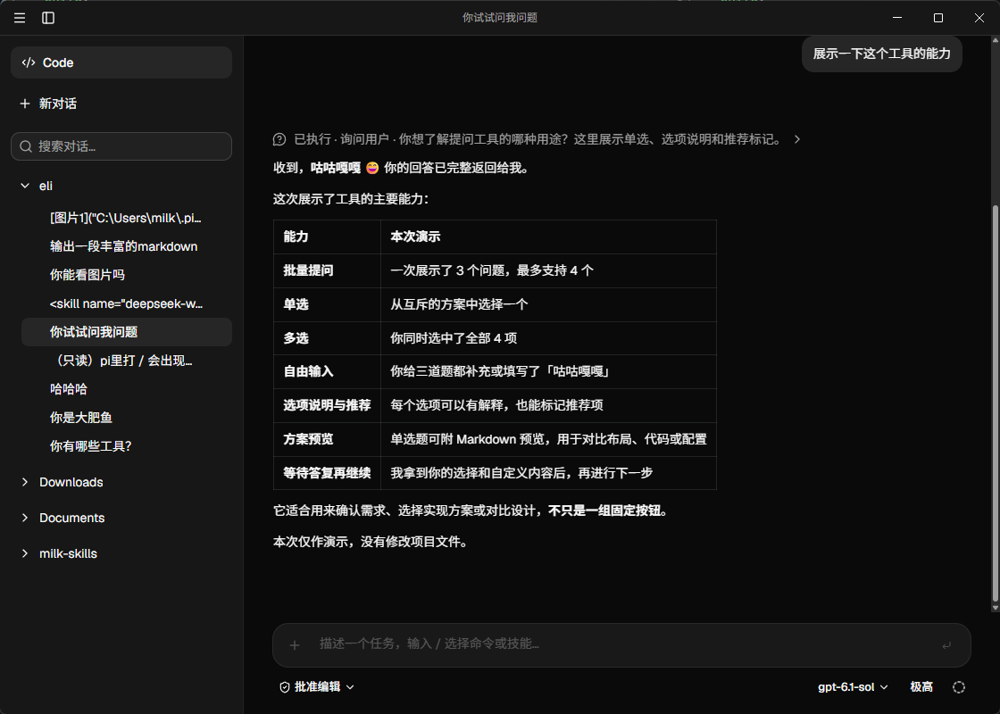

  <h1>eli</h1>
  
<strong>专注对话，从容完成任务。</strong>

  
简洁的 pi 桌面客户端，让对话与工作空间井然有序。

  
Windows · macOS · Linux

---

## 让工作更顺手

- **流畅对话** · 实时呈现回复，随时停止生成。
- **自由选择** · 切换可用模型，按需调整思考强度。
- **有序管理** · 按工作目录整理对话，搜索历史，接续之前的任务。
- **自主掌控** · 选择工具审批方式，查看操作详情后决定是否允许。
- **用量清晰** · 查看近期活跃情况、模型分布与用量趋势。
- **舒适体验** · 支持浅色、深色与跟随系统主题，提供中英文界面。

## 开始之前

首次打开 eli，可直接使用 pi 支持的账号或 API 密钥登录；已有 pi 登录凭据会继续共用。之后可在「设置 → 通用」中登录或更改终端。

首次登录或跳过登录后，可选择命令执行终端。Windows 默认使用 PowerShell，macOS 默认使用 zsh，Linux 默认使用 bash；也支持自动检测已安装终端和填写自定义路径。终端选择仅对 eli 生效，不修改 pi 的配置文件。

设置面板默认只显示 Eli 设置。打开左下角的「打开Pi原生设置」开关后，可查看和修改 Pi 原生设置。

打开 eli，选择工作目录和模型，即可开始对话。历史会话保存在本机，随时可以回来继续。
